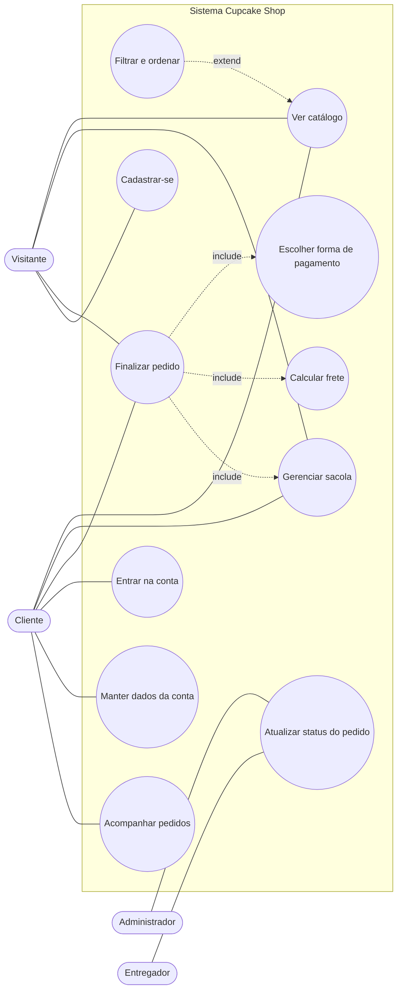

# Diagrama de casos de uso

Os atores e as funções abaixo correspondem às histórias de usuário (`02-user-stories.md`). O Mermaid não tem um diagrama de casos de uso nativo; por isso, ele é representado com um fluxograma: atores à esquerda, casos de uso (elipses) dentro da fronteira do sistema e relações `include` e `extend` em linhas tracejadas.

## Observações

- O **Cliente** é o visitante que já tem conta; tudo o que o visitante faz, ele também pode fazer.
- O **Entregador** não tem tela própria nesta versão: a saída e a entrega são registradas pelo administrador (US13 e US14). Por isso, o ator está ligado ao mesmo caso de uso.
- **Atualizar status do pedido** só pode ser executado com o token administrativo.

## Descrição dos principais casos de uso

### UC04 - Finalizar pedido

| Item | Descrição |
|---|---|
| Atores | Visitante, Cliente |
| Pré-condição | A sacola tem pelo menos um cupcake |
| Fluxo principal | 1. O usuário informa nome, e-mail, telefone e endereço. 2. Escolhe a forma de pagamento. 3. Confirma o pedido. 4. O sistema valida os itens, calcula o total e registra o pedido com o status "recebido". 5. A sacola é esvaziada. |
| Fluxos alternativos | A sacola está vazia: o pedido é recusado. Um produto saiu do catálogo: o sistema pede a remoção do item. O preço de um item mudou: o usuário confirma o novo valor para continuar. O mesmo pedido foi enviado duas vezes: o sistema devolve o pedido original. |
| Pós-condição | O pedido fica registrado com os itens, os valores e a forma de pagamento. Para o cliente logado, os dados de contato ficam salvos como padrão |

### UC11 - Atualizar status do pedido

| Item | Descrição |
|---|---|
| Atores | Administrador (e entregador, por meio dele) |
| Pré-condição | O pedido existe e o token administrativo é válido |
| Fluxo principal | 1. O administrador envia o novo status. 2. O sistema valida o status. 3. O sistema atualiza o pedido. |
| Fluxos alternativos | Token ausente ou inválido: acesso negado (403). Status inválido: pedido recusado. Pedido inexistente: erro "Pedido não encontrado" (404) |
| Pós-condição | O cliente vê o novo status no histórico de pedidos |
