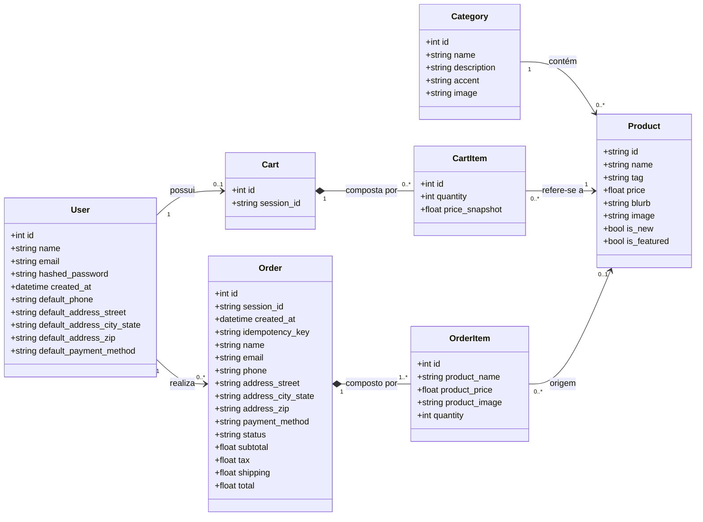

# Diagrama de classes

Classes de persistência (as que viram tabelas), baseadas em `backend/app/models.py`. Os tipos seguem o código (`String`, `Integer`, `Float`, `Boolean`, `DateTime`).

## Descrição das classes

| Classe | Descrição |
|---|---|
| Category | Agrupa os cupcakes em categorias (Clássicos e Especiais), com descrição e imagem de capa |
| Product | Cupcake à venda, com preço, imagem e marcadores de novidade e destaque |
| User | Cliente cadastrado. Guarda a senha criptografada e os dados padrão de contato, endereço e pagamento |
| Cart | Sacola de compras. Pertence a um usuário **ou** a uma sessão de visitante |
| CartItem | Item da sacola. Guarda o preço no momento em que foi adicionado, para detectar mudanças de preço |
| Order | Pedido finalizado, com dados de entrega, forma de pagamento, valores e status. Pertence a um usuário **ou** a uma sessão de visitante |
| OrderItem | Cópia do cupcake no momento da compra (nome, preço e imagem), para o histórico não mudar se o produto for alterado |

## Regras do modelo

- Um carrinho pertence a um usuário **ou** a uma sessão de visitante; um pedido também. Por isso `user_id` e `session_id` são opcionais, mas nunca vazios ao mesmo tempo.
- `status` do pedido aceita: `received`, `preparing`, `out_for_delivery` e `delivered` (padrão: `received`).
- `payment_method` do pedido aceita: `pix`, `credit_card` e `cash_on_delivery`.
- A chave de idempotência é única por usuário e por sessão, o que impede pedidos duplicados.
- `OrderItem.product_id` é opcional: o histórico se mantém mesmo que o produto seja removido do catálogo.
- O e-mail do usuário é único.
