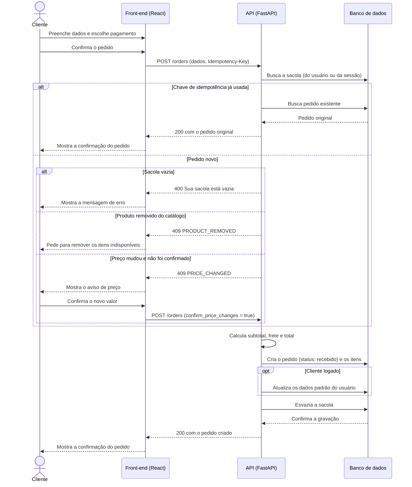
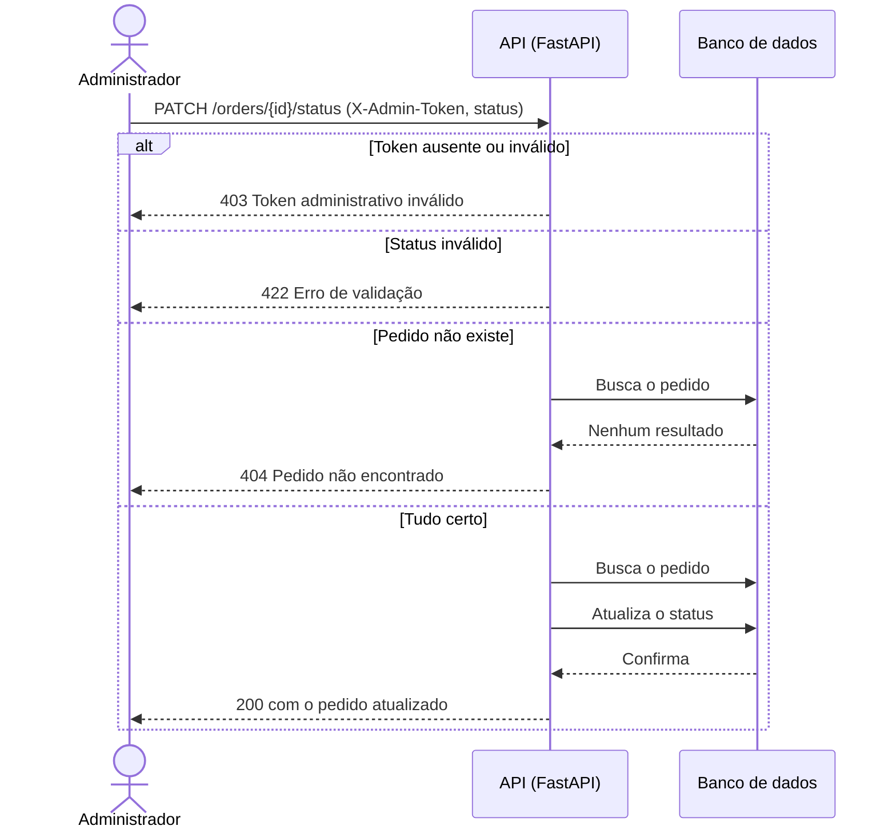

# Diagrama de sequência: finalizar pedido

Fluxo da rota `POST /orders`. O front-end (React) envia o pedido e a API valida a sacola salva no servidor, sem confiar nos preços enviados pelo navegador.

## Sequência secundária: atualizar o status

