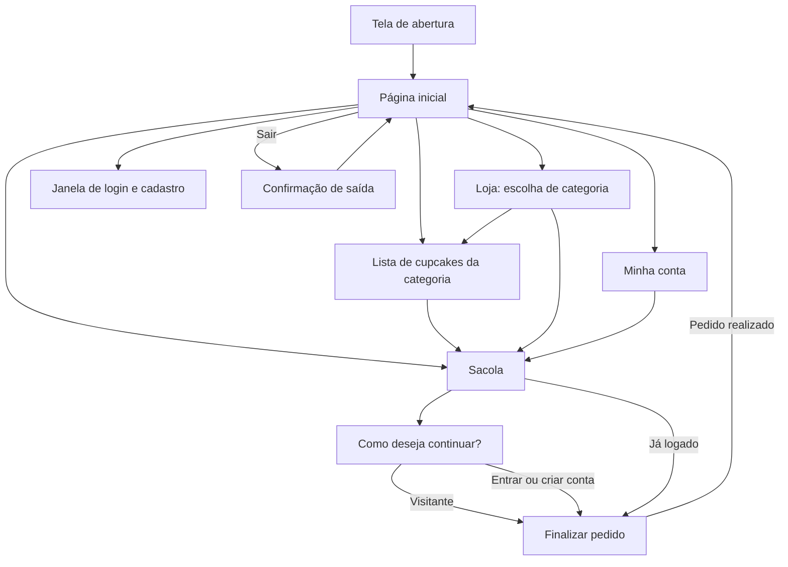
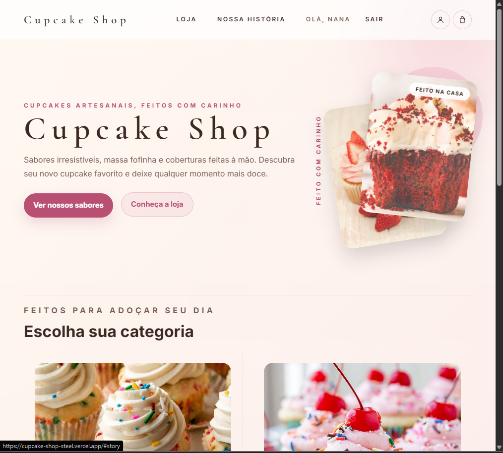
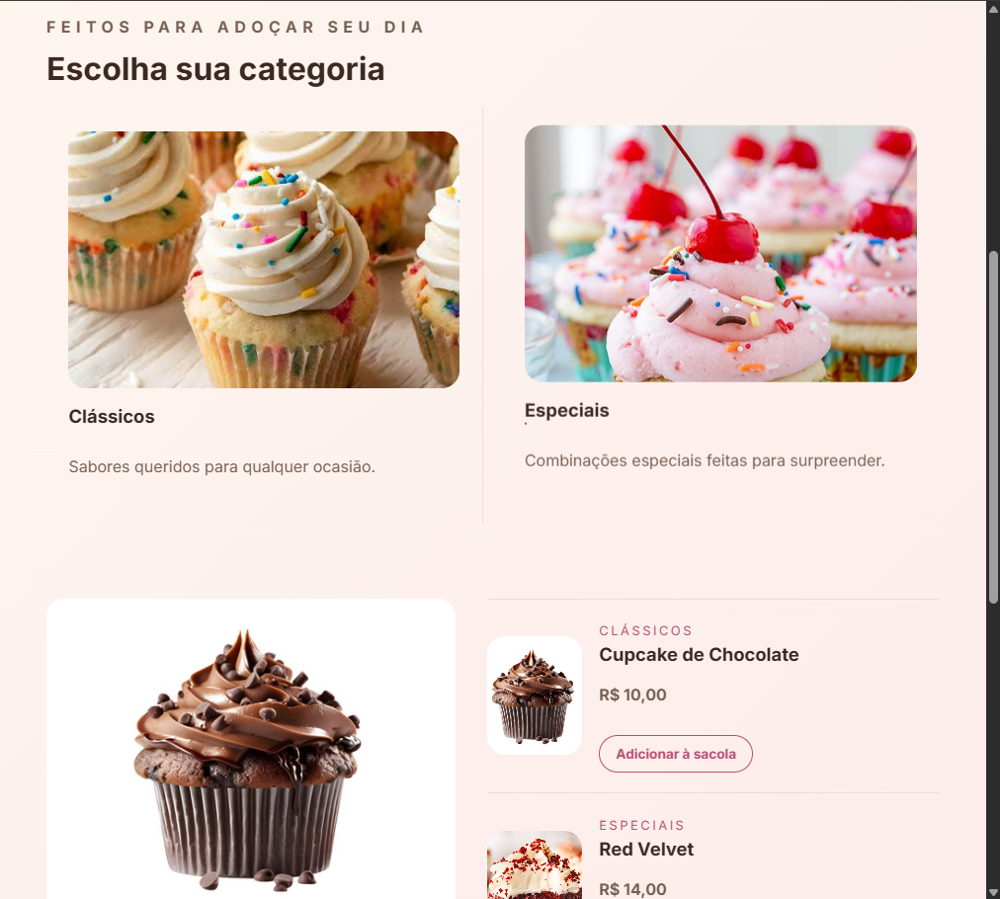
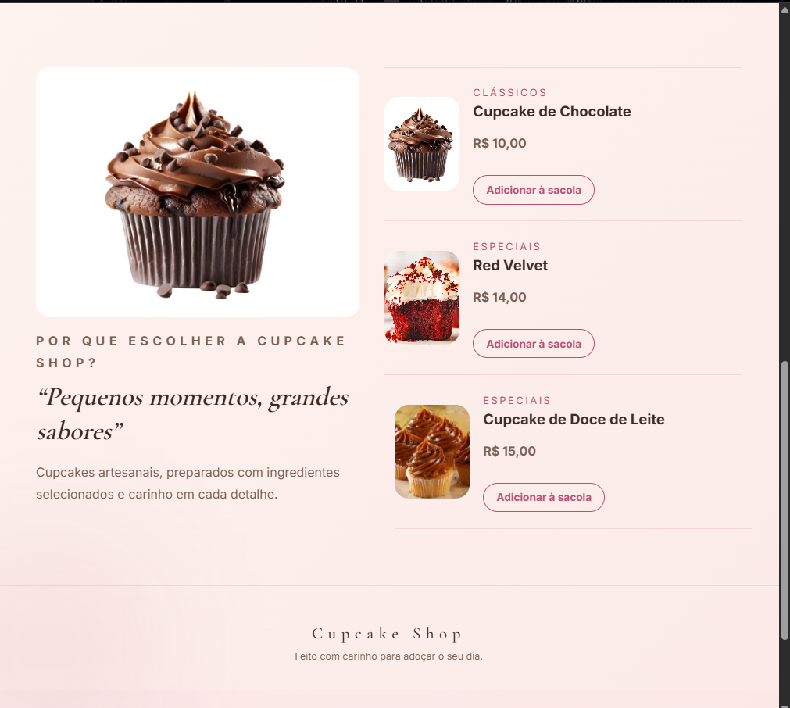
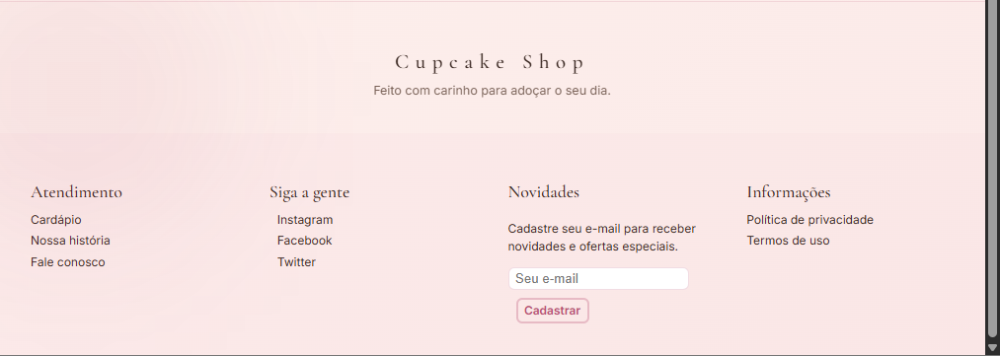
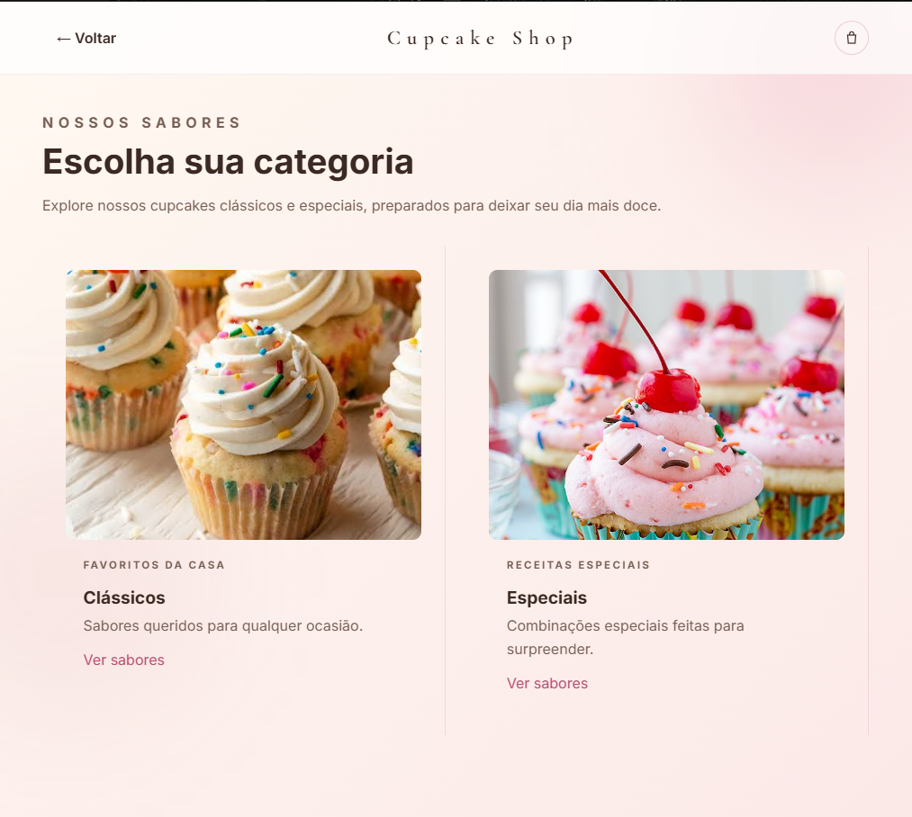
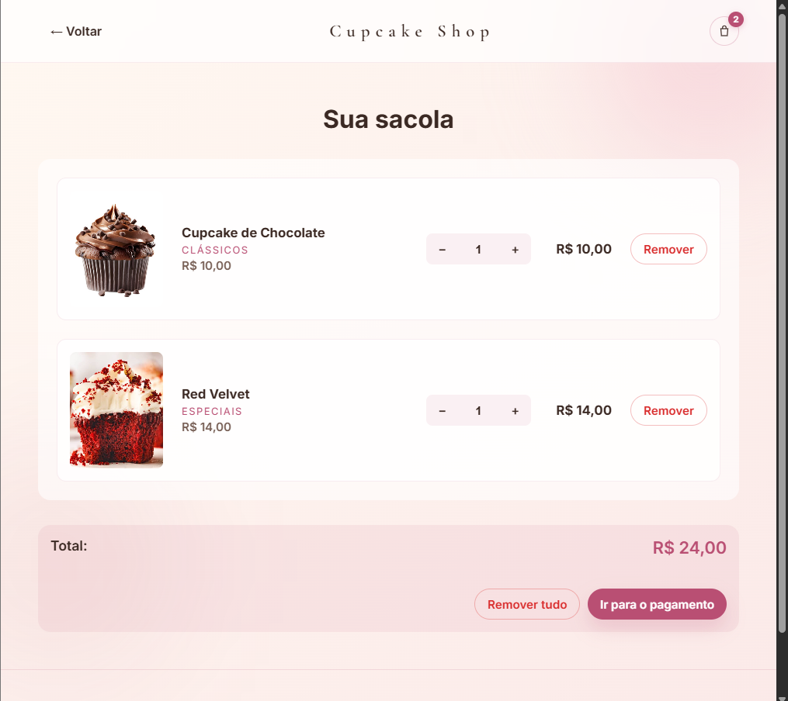
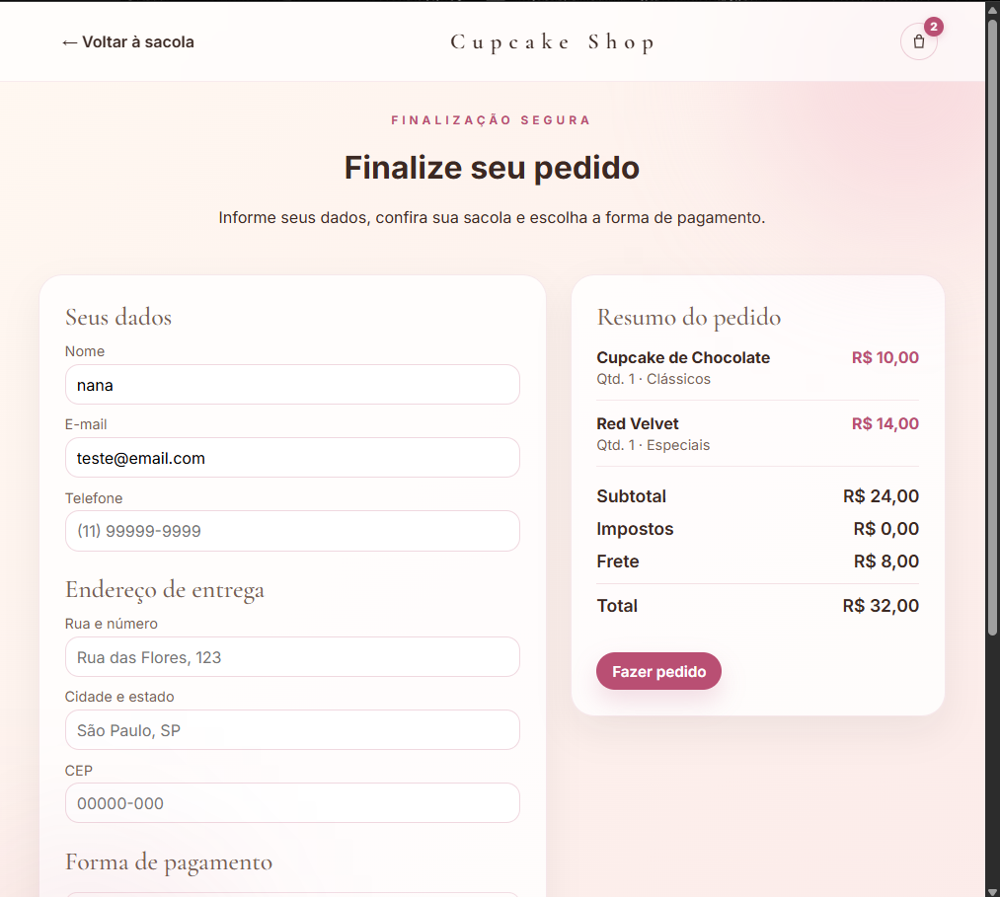
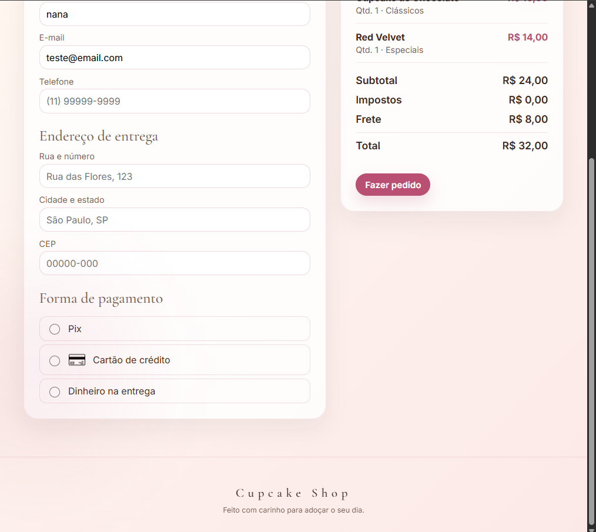
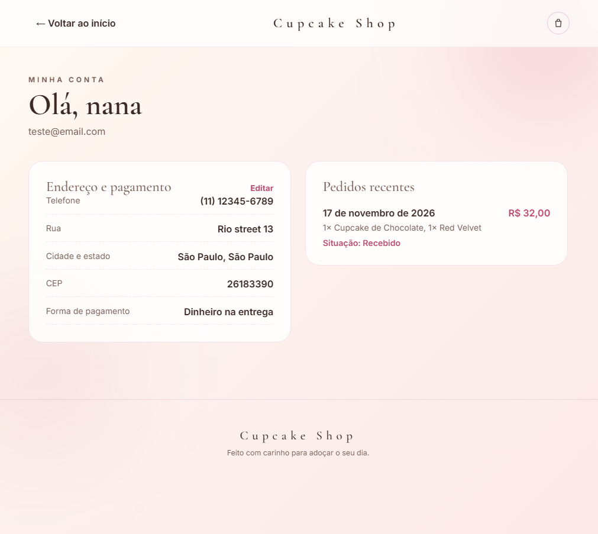

# Interface Humano-Computador (IHC)

Este documento atualiza a IHC do PIT I com as telas reais do sistema publicado: mapa de navegação, descrição das telas, elementos de interface, mensagens do sistema e a revisão feita à luz dos princípios de usabilidade do material da disciplina. As imagens estão em `img/`.

## 1. Princípios de usabilidade aplicados

| Princípio | Como aparece no sistema |
|---|---|
| Clareza | Rótulos diretos ("Adicionar à sacola", "Ir para o pagamento", "Fazer pedido") e o resumo do pedido com subtotal, impostos, frete e total |
| Consistência | Mesma barra de navegação, mesmos botões arredondados na cor rosa e mesmo padrão de cartões em todas as telas |
| Simplicidade | Um objetivo por tela: escolher a categoria, montar a sacola, informar os dados, acompanhar o pedido |
| Controle do usuário | Botões "Voltar" em todas as telas internas; o usuário escolhe se compra como visitante ou com conta |
| Interação direta | Os botões de quantidade (+ e −) atualizam o item e o total na hora |
| Reversibilidade | Itens podem ser removidos ou a sacola esvaziada; o logout pede confirmação ("Continuar conectado") |
| Resposta ao usuário | Notificação ao adicionar um item, mensagens de erro nos formulários e aviso de pedido realizado |
| Estética | Paleta de rosa, creme e marrom-chocolate, fotos grandes e tipografia com serifa nos títulos |

## 2. Mapa de navegação

## 3. Telas do sistema

| # | Tela | Objetivo | Quem acessa |
|---|---|---|---|
| T01 | Abertura | Apresentar a loja e levar o usuário à vitrine | Todos |
| T02 | Página inicial | Apresentar a loja, as categorias e os destaques | Todos |
| T03 | Loja (categorias) | Escolher entre Clássicos e Especiais | Todos |
| T04 | Categoria | Ver os cupcakes, filtrar, ordenar e adicionar à sacola | Todos |
| T05 | Sacola | Revisar itens, mudar quantidades e seguir para o pagamento | Todos |
| T06 | Como deseja continuar | Escolher entre comprar como visitante ou entrar/criar conta | Visitante |
| T07 | Finalizar pedido | Informar os dados, o endereço e a forma de pagamento | Todos |
| T08 | Minha conta | Ver e editar os dados de contato e acompanhar os pedidos | Cliente |
| T09 | Login e cadastro (janela) | Entrar ou criar uma conta | Visitante |

### T02 - Página inicial

- Barra superior com o nome da loja, links Loja e Nossa história, saudação com o nome do cliente ("Olá, Nana"), botão Sair e ícones de conta e sacola.
- Seção de destaque com chamada, texto de apresentação e dois botões: "Ver nossos sabores" (principal) e "Conheça a loja" (secundário).

- A seção "Escolha sua categoria" mostra as duas categorias com foto e descrição.
- Abaixo, a lista de cupcakes com categoria, nome, preço e o botão "Adicionar à sacola".

- O rodapé tem as colunas Atendimento, Siga a gente, Novidades e Informações.

### T03 - Loja (categorias)

- Duas categorias grandes, cada uma com foto, a faixa de destaque ("Favoritos da casa", "Receitas especiais"), descrição e o link "Ver sabores".
- O botão "← Voltar" e o ícone da sacola ficam sempre visíveis.

### T04 - Categoria

- Lista os cupcakes da categoria escolhida, com filtros (Todos, Novidades, Destaques) e ordenação por preço.
- A cada item adicionado, aparece uma notificação "[nome] adicionado à sacola", com o preço.

### T05 - Sacola

- Cada item mostra foto, nome, categoria, preço, quantidade (com − e +), subtotal do item e o botão "Remover".
- No fim, o total e dois botões: "Remover tudo" e "Ir para o pagamento" (principal). O ícone da sacola exibe a quantidade de itens.

### T06 - Como deseja continuar

- Aparece para quem não está logado e tem duas opções em cartões: "Continuar como visitante" e "Entrar ou criar uma conta" (os itens da sacola são mantidos).

### T07 - Finalizar pedido

- À esquerda, três blocos: Seus dados (nome, e-mail, telefone), Endereço de entrega (rua e número, cidade e estado, CEP) e Forma de pagamento (Pix, Cartão de crédito, Dinheiro na entrega).
- À direita, o resumo fixo com os itens, subtotal, impostos, frete e total, além do botão "Fazer pedido".
- Os campos têm exemplos de preenchimento (por exemplo, "(11) 99999-9999").
- Para quem está logado, os campos vêm preenchidos com os dados salvos.

### T08 - Minha conta

- O cartão "Endereço e pagamento" mostra telefone, rua, cidade e estado, CEP e forma de pagamento, com o link "Editar".
- O cartão "Pedidos recentes" lista a data, o valor, os itens e a situação do pedido (por exemplo, "Recebido").

### T09 - Login e cadastro (janela)

- Janela com as abas "Entrar" e "Criar conta", campos de e-mail e senha (mínimo de 6 caracteres) e o botão principal. Também pode ser fechada pelo "X".

## 4. Elementos de interface utilizados

| Categoria | Elementos |
|---|---|
| Controles de entrada | Campos de texto, campo de e-mail, campo de senha, botões de opção (pagamento), botões de quantidade (+ e −), botões de filtro, lista de ordenação |
| Navegação | Barra superior, botões "Voltar", links de seção (Loja, Nossa história), ícones de conta e sacola com contador |
| Informativos | Notificações (adicionou à sacola, pedido realizado), mensagens de erro em vermelho, janela de confirmação de saída |
| Recipientes | Cartões de categoria, de produto, de resumo do pedido e de conta |

## 5. Mensagens do sistema

| Situação | Mensagem exibida |
|---|---|
| Cadastro com e-mail existente | Este e-mail já está cadastrado |
| Login inválido | E-mail ou senha inválidos |
| Sessão vencida | Sua sessão expirou. Entre novamente. |
| Checkout sem nome, e-mail ou telefone | Preencha seu nome, e-mail e telefone para continuar. |
| Checkout sem forma de pagamento | Escolha uma forma de pagamento para continuar. |
| Sacola vazia ao finalizar | Sua sacola está vazia |
| Item removido do catálogo | Estes itens não estão mais disponíveis. Remova-os da sua sacola |
| Preço alterado | O preço de um ou mais itens mudou. Confira e confirme para continuar. |
| Falha genérica | Algo deu errado. Tente novamente. |
| Item adicionado | [nome] adicionado à sacola |
| Pedido concluído | Pedido realizado com sucesso! Obrigado por escolher a Cupcake Shop. |
| Logout | Sair da Cupcake Shop? Você poderá entrar novamente quando quiser. |

## 6. Revisão da IHC (melhoria contínua)

Ao comparar as telas publicadas com os princípios do item 1, foram identificados os pontos abaixo.

| Ponto | Problema | Princípio afetado | Situação |
|---|---|---|---|
| Total da sacola sem frete | A sacola mostra "Total: R$ 24,00", mas o checkout mostra R$ 32,00 (com frete de R$ 8,00) | Clareza e consistência | A corrigir |
| Rodapé da home com elementos sem função | Os botões de redes sociais, o formulário de newsletter, "Fale conosco" e os links de privacidade e termos não levam a lugar nenhum | Clareza e resposta ao usuário | A corrigir |
| Erro de conexão em inglês | Se a API não responder, o navegador mostra "Failed to fetch" | Clareza e empatia | A corrigir |
| Pedido concluído sem tela de confirmação | O aviso é uma notificação de alguns segundos na página inicial, sem número do pedido | Resposta ao usuário | Próxima versão |
| Linha "Impostos R$ 0,00" | A loja não cobra impostos, mas a linha aparece no resumo | Simplicidade | A avaliar |
| Sem painel administrativo | A atualização de status é feita por rota protegida, e não por uma tela | Controle do usuário | Fora do escopo (ver `01-escopo.md`) |

As correções serão registradas no laudo de qualidade (Situação 3), junto com o feedback dos testadores.

## 7. Protótipo

O protótipo do PIT I foi substituído pelo sistema funcional publicado, cujas telas estão documentadas acima. O fluxo principal é: abertura, página inicial, categoria, sacola, finalização do pedido e acompanhamento na conta.
