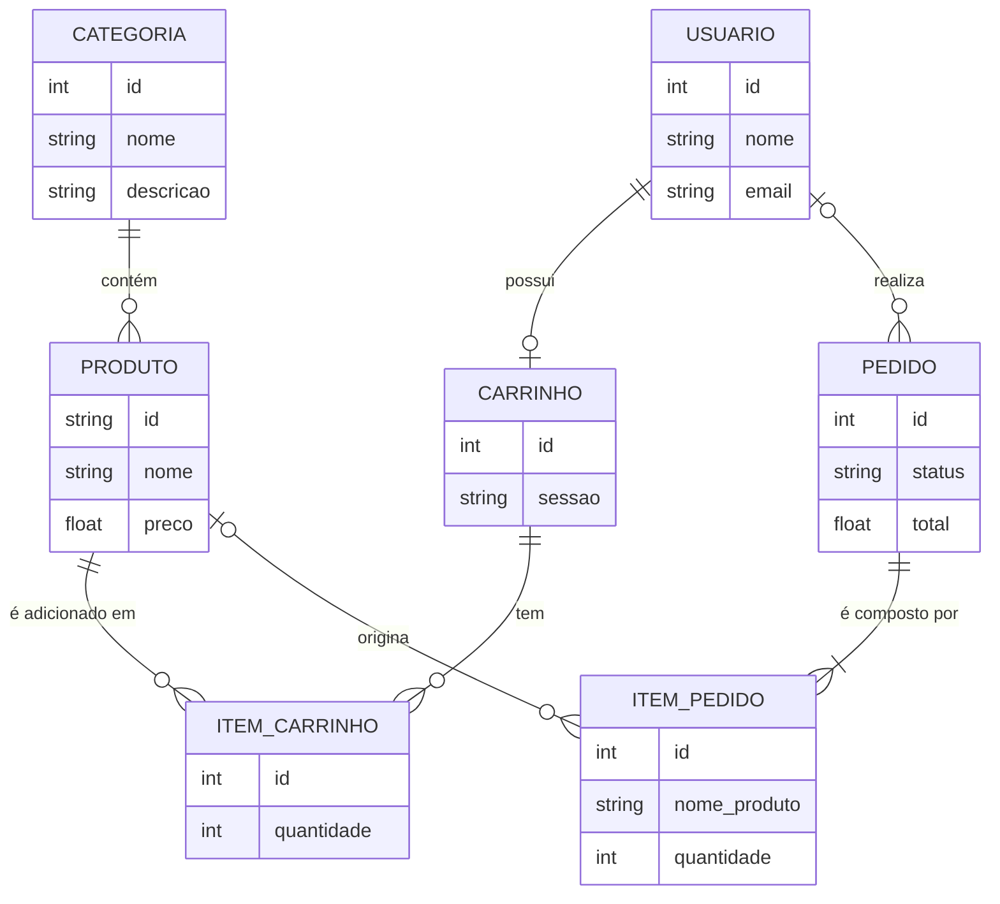

# Modelo de dados

O modelo é apresentado em três níveis: conceitual (entidades e relacionamentos), lógico normalizado (tabelas, chaves e normalização) e físico (PostgreSQL). O dicionário de dados está em `10-dicionario-de-dados.md`. A base é o arquivo `backend/app/models.py`.

## 1. Projeto conceitual



Os atributos completos estão no diagrama de classes (`05-diagrama-de-classes.md`) e no dicionário de dados. Aqui aparecem só os principais, para mostrar os relacionamentos.

### Regras de negócio que moldam o modelo

- Uma categoria tem vários produtos, e cada produto pertence a uma categoria.
- Um usuário tem no máximo um carrinho. Um visitante tem um carrinho identificado pela sessão do navegador.
- Um pedido pertence a um usuário **ou** a uma sessão de visitante (compra sem conta).
- Um pedido tem pelo menos um item. Cada item guarda uma cópia do nome, preço e imagem do produto no momento da compra.
- O produto de um item de pedido é opcional, para que o histórico continue válido se o produto sair do catálogo.

## 2. Projeto lógico normalizado

Notação: **PK** = chave primária, **FK** = chave estrangeira, **UK** = valor único, **NN** = não nulo.

```
categories   (id PK, name UK NN, description, accent, image)

products     (id PK, name, tag, price, blurb, image, is_new, is_featured,
              category_id FK -> categories.id)

users        (id PK, name, email UK NN, hashed_password NN, created_at,
              default_phone, default_address_street, default_address_city_state,
              default_address_zip, default_payment_method)

carts        (id PK, session_id UK, user_id FK UK -> users.id)

cart_items   (id PK, cart_id FK -> carts.id, product_id FK -> products.id,
              quantity, price_snapshot)

orders       (id PK, user_id FK -> users.id, session_id, created_at,
              idempotency_key, name, email, phone, address_street,
              address_city_state, address_zip, payment_method, status NN,
              subtotal, tax, shipping, total,
              UK (user_id, idempotency_key), UK (session_id, idempotency_key))

order_items  (id PK, order_id FK -> orders.id, product_id FK -> products.id,
              product_name, product_price, product_image, quantity)
```

### Verificação da normalização

| Forma normal | Verificação |
|---|---|
| 1FN | Todos os campos são atômicos, sem listas nem grupos repetidos. Os itens do carrinho e do pedido ficam em tabelas próprias. |
| 2FN | Todas as tabelas têm chave primária simples (`id`), então não há dependência parcial. |
| 3FN | Nas tabelas `categories`, `products`, `users`, `carts` e `cart_items`, nenhum atributo depende de outro atributo que não seja a chave. A categoria do produto está em tabela própria. |

### Desnormalizações intencionais

Algumas colunas repetem informação de propósito, para preservar o histórico ou para detectar mudanças:

| Onde | O que repete | Por quê |
|---|---|---|
| `order_items` | `product_name`, `product_price`, `product_image` | O pedido não deve mudar se o produto for renomeado, reprecificado ou removido |
| `orders` | `name`, `email`, `phone` e endereço | Registra os dados informados naquela compra, inclusive de visitantes |
| `orders` | `subtotal`, `tax`, `shipping`, `total` | Guarda os valores cobrados na época, mesmo que as regras de frete mudem depois |
| `cart_items` | `price_snapshot` | Serve para detectar mudança de preço no checkout. O valor cobrado vem sempre de `products.price` |
| `users` | `default_*` | Dados que preenchem o checkout automaticamente |

### Pontos de atenção do modelo

- O usuário e a sessão de visitante são mutuamente exclusivos em `carts` e `orders`. Essa regra é garantida pela aplicação, e não por uma restrição do banco.
- Os valores de `status` e `payment_method` são validados pela API (e não por restrição no banco). Os valores aceitos estão no dicionário de dados.
- Os valores em dinheiro usam ponto flutuante (`Float`). Para uma versão de produção, o recomendado é `NUMERIC(10,2)`, que evita erros de arredondamento.

## 3. Projeto físico (PostgreSQL)

As tabelas são criadas pelo SQLAlchemy (`Base.metadata.create_all`, chamado pelo `app.seed`). O script abaixo é o equivalente em SQL para PostgreSQL e serve como referência da estrutura implantada.

```sql
CREATE TABLE categories (
    id           SERIAL PRIMARY KEY,
    name         VARCHAR UNIQUE,
    description  VARCHAR,
    accent       VARCHAR,
    image        VARCHAR
);
CREATE INDEX ix_categories_id   ON categories (id);
CREATE UNIQUE INDEX ix_categories_name ON categories (name);

CREATE TABLE products (
    id           VARCHAR PRIMARY KEY,
    name         VARCHAR,
    tag          VARCHAR,
    price        DOUBLE PRECISION,
    blurb        VARCHAR,
    image        VARCHAR,
    is_new       BOOLEAN DEFAULT FALSE,
    is_featured  BOOLEAN DEFAULT FALSE,
    category_id  INTEGER REFERENCES categories (id)
);

CREATE TABLE users (
    id                          SERIAL PRIMARY KEY,
    name                        VARCHAR,
    email                       VARCHAR NOT NULL UNIQUE,
    hashed_password             VARCHAR NOT NULL,
    created_at                  TIMESTAMP,
    default_phone               VARCHAR,
    default_address_street      VARCHAR,
    default_address_city_state  VARCHAR,
    default_address_zip         VARCHAR,
    default_payment_method      VARCHAR
);
CREATE UNIQUE INDEX ix_users_email ON users (email);

CREATE TABLE carts (
    id          SERIAL PRIMARY KEY,
    session_id  VARCHAR UNIQUE,
    user_id     INTEGER UNIQUE REFERENCES users (id)
);

CREATE TABLE cart_items (
    id              SERIAL PRIMARY KEY,
    cart_id         INTEGER REFERENCES carts (id),
    product_id      VARCHAR REFERENCES products (id),
    quantity        INTEGER DEFAULT 1,
    price_snapshot  DOUBLE PRECISION
);

CREATE TABLE orders (
    id                  SERIAL PRIMARY KEY,
    user_id             INTEGER REFERENCES users (id),
    session_id          VARCHAR,
    created_at          TIMESTAMP,
    idempotency_key     VARCHAR,
    name                VARCHAR,
    email               VARCHAR,
    phone               VARCHAR,
    address_street      VARCHAR,
    address_city_state  VARCHAR,
    address_zip         VARCHAR,
    payment_method      VARCHAR,
    status              VARCHAR NOT NULL DEFAULT 'received',
    subtotal            DOUBLE PRECISION,
    tax                 DOUBLE PRECISION,
    shipping            DOUBLE PRECISION,
    total               DOUBLE PRECISION,
    CONSTRAINT uq_order_user_idempotency_key    UNIQUE (user_id, idempotency_key),
    CONSTRAINT uq_order_session_idempotency_key UNIQUE (session_id, idempotency_key)
);
CREATE INDEX ix_orders_session_id      ON orders (session_id);
CREATE INDEX ix_orders_idempotency_key ON orders (idempotency_key);

CREATE TABLE order_items (
    id             SERIAL PRIMARY KEY,
    order_id       INTEGER REFERENCES orders (id),
    product_id     VARCHAR REFERENCES products (id),
    product_name   VARCHAR,
    product_price  DOUBLE PRECISION,
    product_image  VARCHAR,
    quantity       INTEGER DEFAULT 1
);
```

Observações:

- O SQLAlchemy também cria índices simples em colunas marcadas com `index=True` (por exemplo, `id` de cada tabela). Eles estão omitidos aqui, exceto os que importam para o negócio (`email`, `name` e `session_id`).
- O valor padrão `'received'` de `orders.status` é aplicado pela aplicação ao criar o pedido.
- O SGBD escolhido é o **PostgreSQL**, um banco relacional popular e de fácil manutenção, hospedado no Render. Em desenvolvimento, a aplicação usa SQLite por conveniência.
