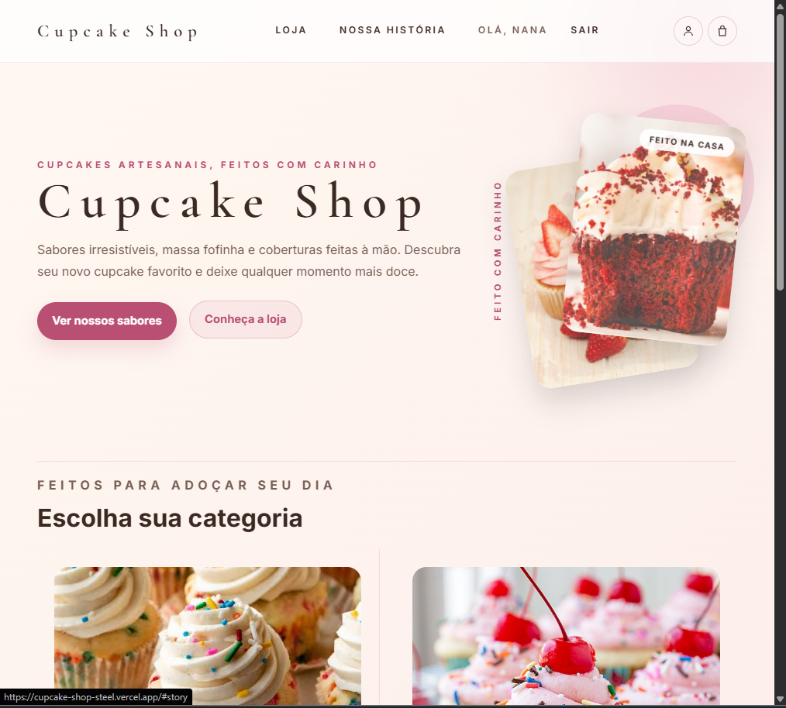
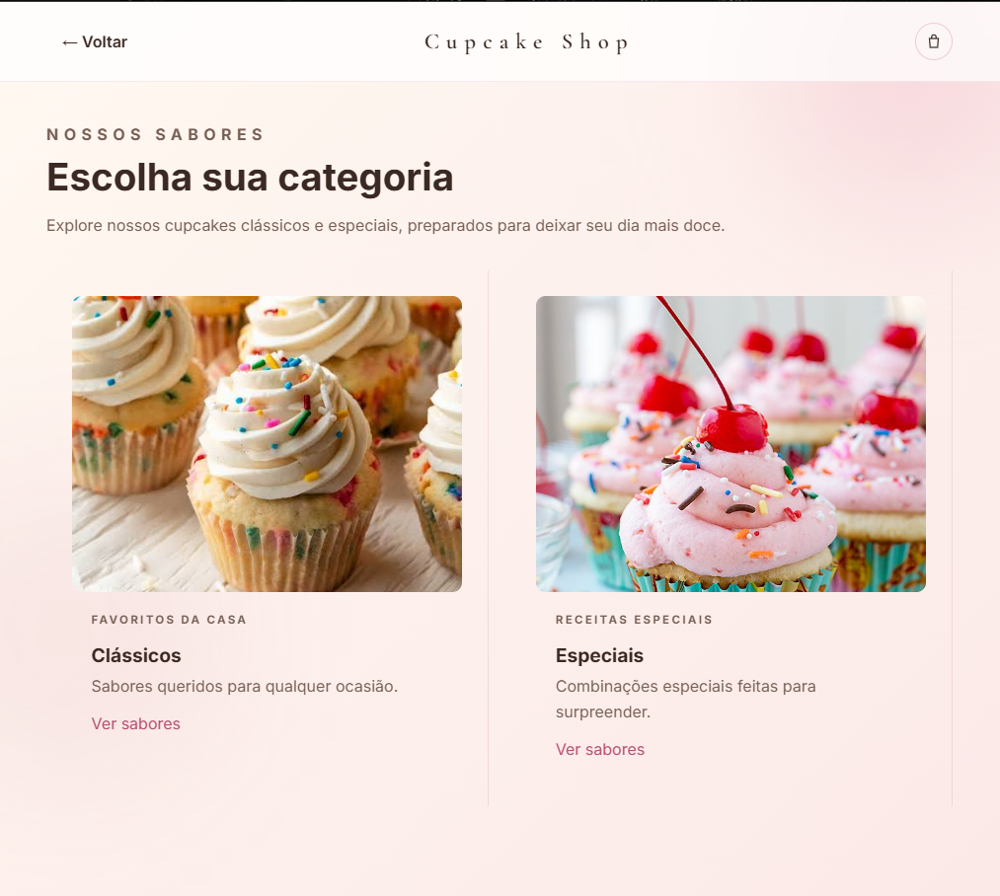
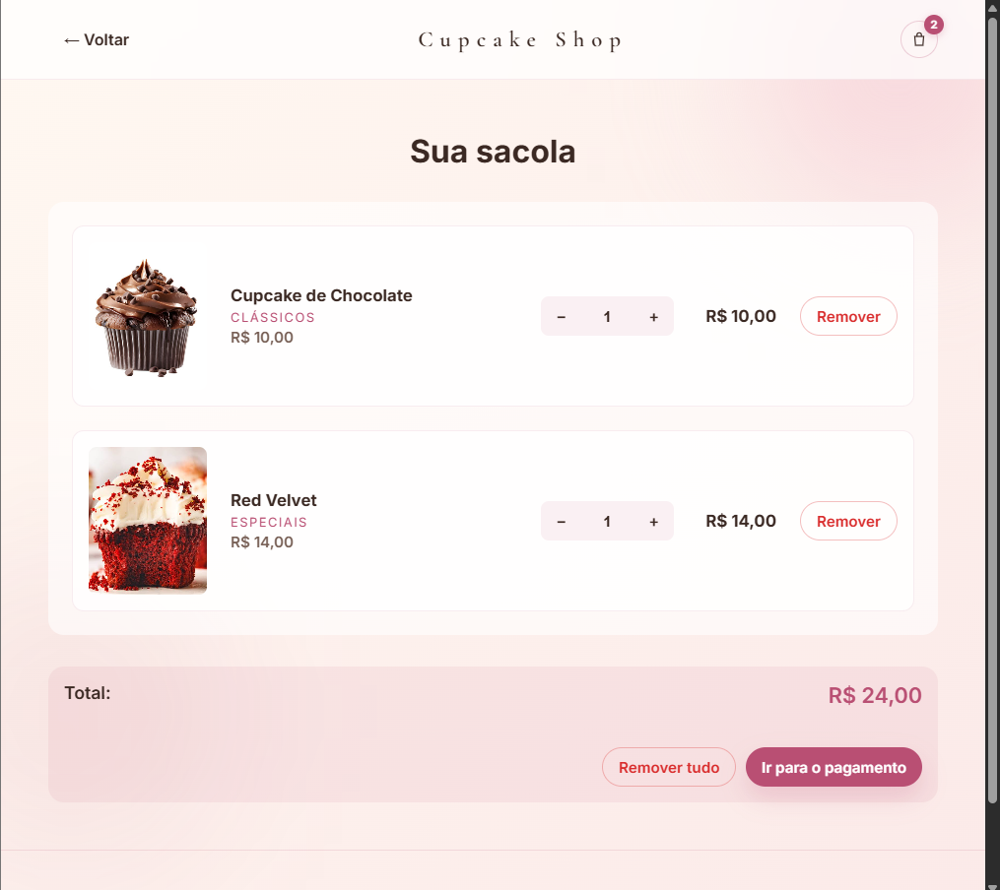
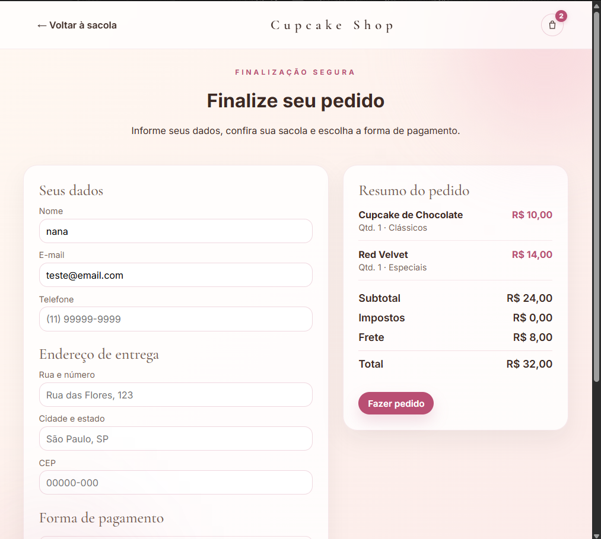
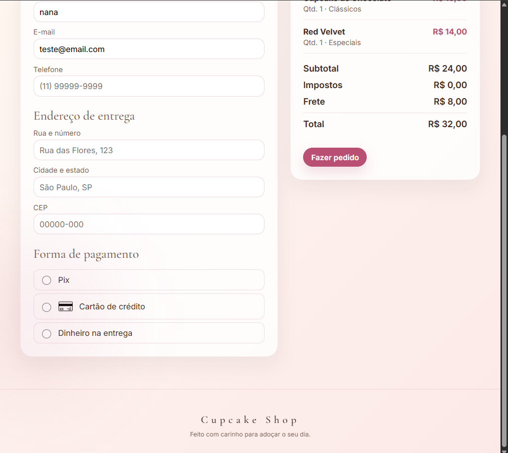
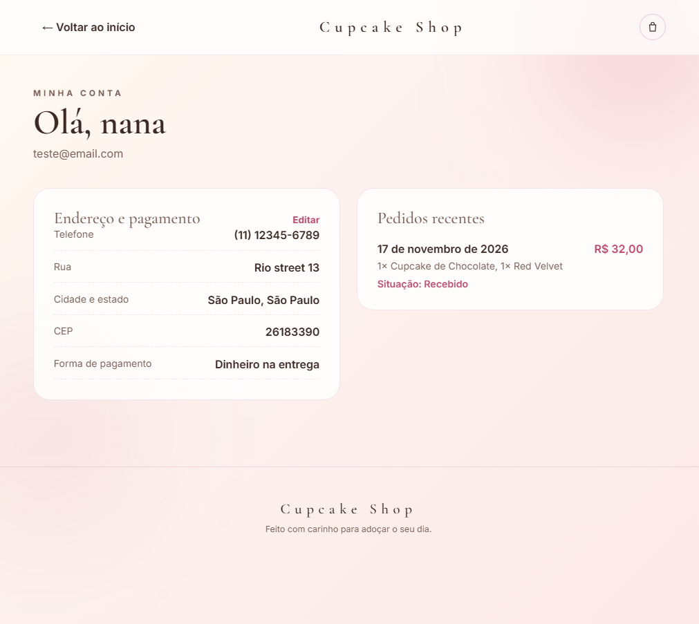

# Manual de uso da Cupcake Shop

Site: https://cupcake-shop-steel.vercel.app/

> A API fica em hospedagem gratuita. Se o site demorar cerca de 1 minuto no primeiro acesso, é normal: o servidor está "acordando".

## Para o cliente

### 1. Entrar na loja
Ao abrir o site, aparece a tela de abertura. Clique no botão para entrar na vitrine.



### 2. Escolher os cupcakes
1. Na página inicial, role até "Escolha sua categoria" ou clique em **Loja** na barra superior.
2. Escolha **Clássicos** ou **Especiais** e clique em **Ver sabores**.
3. Na lista, use os filtros **Todos**, **Novidades** e **Destaques** e a ordenação por preço, se quiser.



### 3. Adicionar à sacola
Clique em **Adicionar à sacola** no cupcake desejado. Uma notificação confirma o item adicionado e o contador no ícone da sacola aumenta.

### 4. Revisar a sacola
Clique no ícone da sacola. Na tela da sacola você pode:
- aumentar ou diminuir a quantidade com **+** e **−**;
- remover um item com **Remover**;
- esvaziar tudo com **Remover tudo**;
- conferir subtotal, frete e total.

O frete é de R$ 8,00 e fica grátis para pedidos acima de R$ 80,00.



### 5. Finalizar o pedido
1. Clique em **Ir para o pagamento**.
2. Se você não estiver logado, escolha **Continuar como visitante** ou **Entrar ou criar uma conta** (os itens da sacola são mantidos).
3. Preencha nome, e-mail, telefone e o endereço de entrega.
4. Escolha a forma de pagamento: **Pix**, **Cartão de crédito** ou **Dinheiro na entrega**. O pagamento é simulado, e nenhum valor é cobrado.
5. Confira o resumo e clique em **Fazer pedido**.





Se um preço mudou ou um item saiu do catálogo, o sistema avisa antes de concluir. Confirme o novo valor ou remova o item indisponível. Ao terminar, aparece a mensagem "Pedido realizado com sucesso!".

### 6. Criar conta e entrar
1. Na página inicial, clique no ícone de conta.
2. Na aba **Criar conta**, informe nome, e-mail e senha (mínimo de 6 caracteres). Na aba **Entrar**, informe e-mail e senha.
3. Se você já tinha itens na sacola como visitante, eles são somados à sua sacola ao entrar.

### 7. Acompanhar os pedidos
Com a conta ativa, clique em **Olá, [seu nome]** (ou no ícone de conta). Em **Minha conta** você vê:
- seus dados de telefone, endereço e forma de pagamento padrão (botão **Editar**);
- os pedidos recentes e a **situação** de cada um: Recebido, Em preparo, Saiu para entrega ou Entregue.



### 8. Sair
Clique em **Sair** e confirme. A opção **Continuar conectado** cancela a saída.

## Para o administrador (atualizar o status de um pedido)

Nesta versão não existe tela administrativa. O status é atualizado por uma rota protegida, usando o token configurado na variável `ADMIN_TOKEN` do servidor.

Exemplo no PowerShell (troque o endereço da API, o número do pedido e o token):

```powershell
Invoke-RestMethod -Method Patch -Uri "https://SUA-API.onrender.com/orders/1/status" `
  -Headers @{ "X-Admin-Token" = "SEU_ADMIN_TOKEN" } `
  -ContentType "application/json" `
  -Body '{"status":"preparing"}'
```

Status aceitos:

| Valor enviado | Exibido ao cliente |
|---|---|
| `received` | Recebido |
| `preparing` | Em preparo |
| `out_for_delivery` | Saiu para entrega |
| `delivered` | Entregue |

Respostas possíveis: **200** (atualizado), **403** (token ausente ou inválido), **404** (pedido não encontrado) e **422** (status inválido).

## Problemas comuns

| Situação | O que fazer |
|---|---|
| "Não foi possível conectar ao servidor" | Aguarde cerca de 1 minuto e tente de novo (o servidor gratuito estava dormindo) |
| "E-mail ou senha inválidos" | Confira os dados ou crie uma conta |
| "Este e-mail já está cadastrado" | Use a aba **Entrar** |
| Aviso de item indisponível no pedido | Volte à sacola e remova o item indicado |
| Aviso de mudança de preço | Confira o novo valor e confirme para concluir |

## Executar o projeto localmente

As instruções para rodar o back-end e o front-end no seu computador e executar os testes estão no `README.md` da raiz do repositório.
