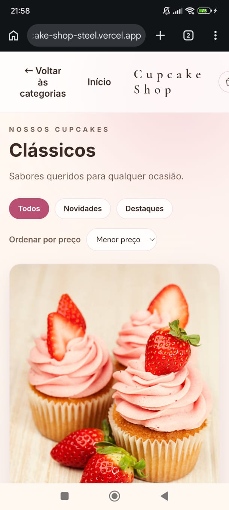
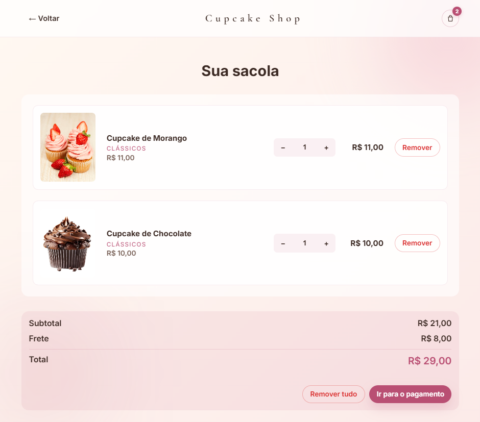
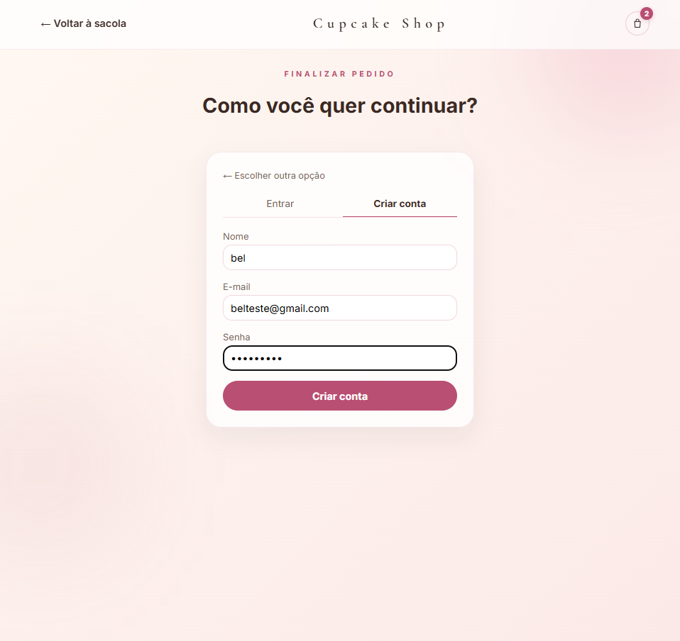
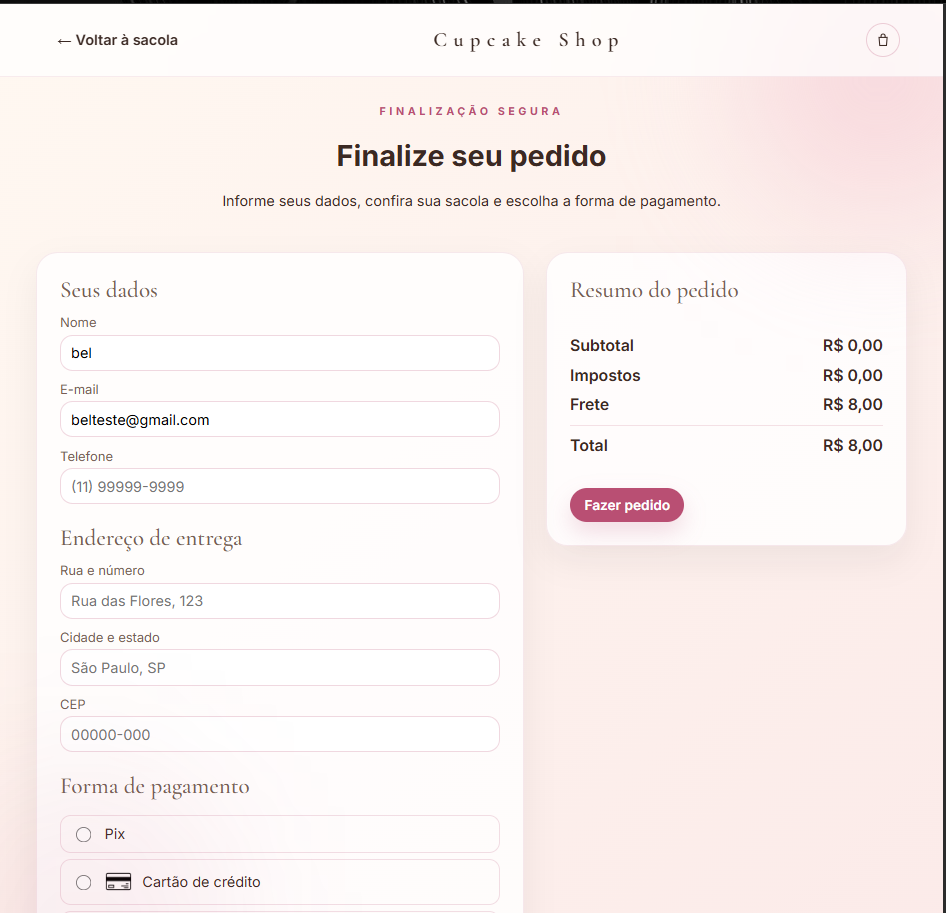
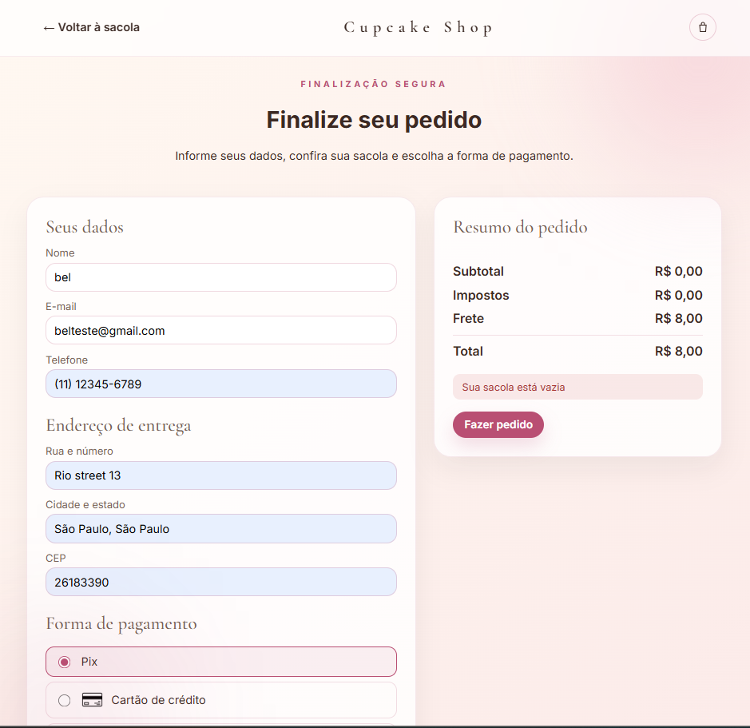
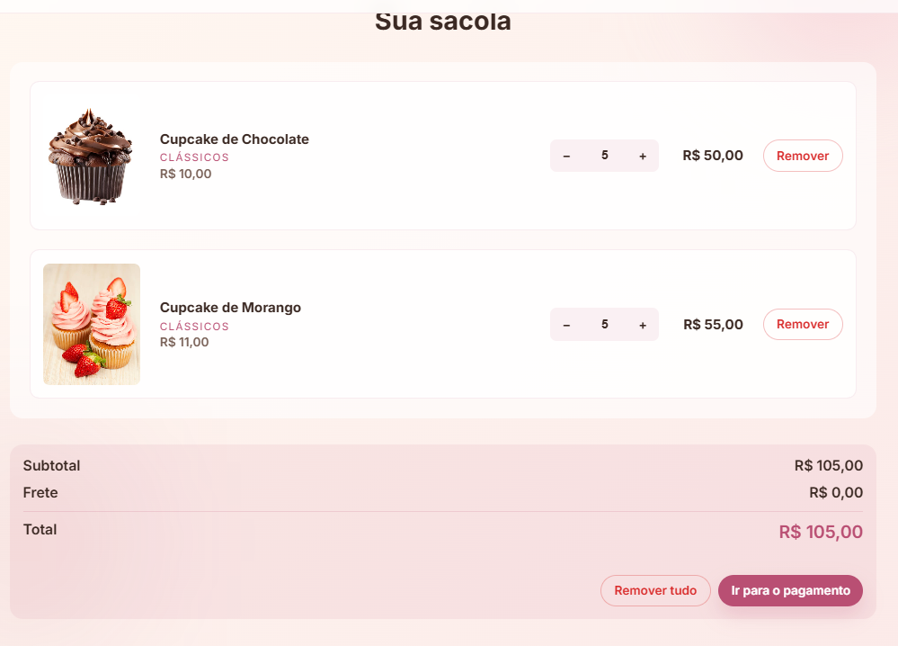
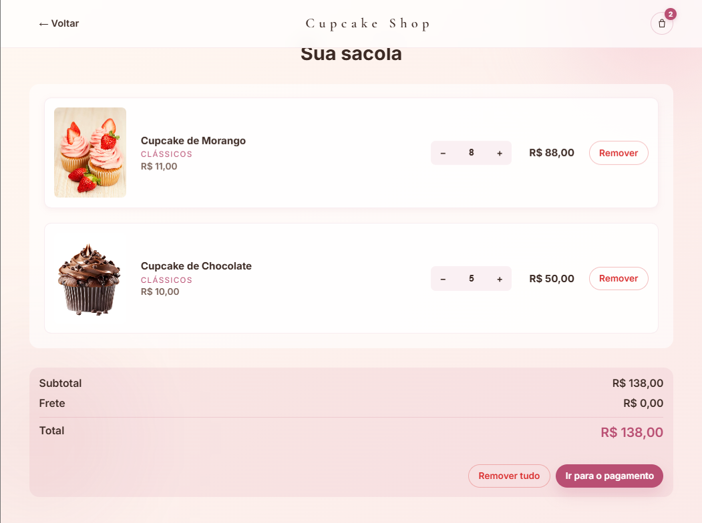

# Laudo de qualidade

## Resumo

O sistema foi verificado por testes automatizados (66 no back-end e 16 no front-end, todos aprovados) e validado por 4 colegas. Os problemas encontrados foram corrigidos e registrados abaixo, com a evidência de cada um.

| Origem | Defeitos encontrados | Corrigidos | Pendentes |
|---|---|---|---|
| Revisão interna da IHC | 3 | 3 | 0 |
| Testes com colegas | 3 | 3 | 0 |

## 1. Defeitos encontrados nos testes com colegas

### D1: Ícone da sacola não aparece no celular
- **Reportado por:** Fernando Lucena, em 17/11/2026.
- **Onde:** página de categoria (por exemplo, Clássicos), em tela de celular.
- **Problema:** o cabeçalho tinha mais conteúdo do que cabia na largura do celular. O título da loja quebrava em duas linhas e o ícone da sacola ficava cortado na borda da tela, impedindo ver a quantidade de itens e abrir a sacola.
- **Evidência (antes):** `evidencias/01-sacola-celular-antes.jpeg`.

- **Correção:** commit `2eaa44a` ("fix: keep category navigation and cart indicator visible on mobile"). O texto do botão "Voltar às categorias" ganhou uma versão curta ("← Categorias") para telas pequenas, o ícone da sacola passou a ter um contêiner próprio, o corte de conteúdo da página foi ajustado e o rótulo do botão passou a informar a quantidade de itens para leitores de tela. Foi criado o teste `CategoryPage.test.js`, que garante que o botão da sacola fica acessível e mostra o contador.
- **Evidência (depois):** [inserir print do celular depois da correção]
- **Situação:** corrigido.

### D2: Sacola de visitante some depois de entrar na conta
- **Reportado por:** Bel Aly, em 17/11/2026.
- **Onde:** fluxo de compra, ao passar de visitante para cliente.
- **Problema:** ao adicionar cupcakes à sacola sem estar logada e depois entrar na conta, os itens desapareciam. A expectativa da testadora era que a sacola de visitante fosse somada à sacola da conta.
- **Causa (confirmada pelos prints):** o problema ocorria ao **criar a conta** na etapa de pagamento. O login já somava a sacola de visitante à da conta (US02), mas o **cadastro** não recebia o identificador da sessão do visitante, então a sacola ficava para trás ao criar uma conta nova.
- **Correção:** commit `7f612f0` ("feat: merge guest carts on signup and add project QA documentation"). O cadastro passou a receber a sessão do visitante e a somar a sacola à da conta nova. A regra de mesclagem foi isolada em uma função usada pelo cadastro e pelo login. Foi criado o teste `test_register_merges_guest_cart_into_new_user_cart`, que verifica que a sacola do usuário recebe os itens e a sacola de visitante fica vazia.
- **Evidência (antes):** prints enviados pela testadora, feitos às 22h39 e 22h41 de 17/11/2026 (a correção foi publicada às 22h48).

Sacola de visitante com 2 cupcakes (subtotal R$ 21,00):

Criação da conta na etapa de pagamento ("Criar conta"):

Depois do cadastro, a sacola aparece vazia (subtotal R$ 0,00 e ícone da sacola sem contador):

Ao tentar concluir, o sistema recusa o pedido com "Sua sacola está vazia":

- **Evidência (depois):** teste automatizado aprovado (66 testes no back-end). [inserir print do site publicado com a sacola mantida após criar uma conta]
- **Situação:** corrigido.

### D3: Itens da sacola mudam de posição ao clicar no +
- **Reportado por:** Destiny Levi, em 17/11/2026.
- **Onde:** página da sacola, com mais de um cupcake.
- **Problema:** ao clicar no "+" de um item, a ordem dos itens mudava e o que estava embaixo "subia". Nos prints, o Cupcake de Morango (que era o segundo da lista) vai para o primeiro lugar ao subir de 5 para 8 unidades. Os valores (subtotal e total) continuavam corretos, mas a lista se reorganizava sozinha e confundia o usuário.
- **Evidência (antes):** prints das 23h14 de 17/11/2026 (a correção foi publicada às 23h26).

Sacola com Chocolate (5) e Morango (5):

Depois de clicar no "+" do Morango (8 unidades), a ordem dos itens trocou:

- **Correção:** commit `ce33668` ("fix: add cupcakes change order"), que ajustou o layout dos itens da sacola (alinhamento e efeito de elevação ao passar o mouse). [Se a ordenação dos itens também for fixada no back-end, acrescentar o commit aqui.]
- **Evidência (depois):** [inserir print da sacola com 2 itens, mostrando que a ordem não muda ao clicar no +]
- **Situação:** [confirmar no site publicado depois do deploy]

## 2. Sugestões recebidas

| Sugestão | Autor | Decisão |
|---|---|---|
| Barra de menu sempre visível, para facilitar ver quando há itens na sacola | Fernando Lucena | [decidir: implementada, ou registrada para a próxima versão] |

## 3. Defeitos encontrados na revisão interna (antes dos testes com colegas)

A revisão da IHC (ver `../situacao-1/08-ihc.md`) identificou três problemas, todos corrigidos no commit `a30debe`.

| # | Defeito | Correção | Teste automatizado |
|---|---|---|---|
| R1 | A sacola mostrava R$ 24,00, mas o checkout cobrava R$ 32,00 (frete não aparecia na sacola) | A sacola passou a mostrar subtotal, frete e total, usando a mesma regra do checkout | `CartPage.test.js` (frete no limite de R$ 80,00 e acima dele) |
| R2 | Rodapé da página inicial com botões e links sem destino (redes sociais, newsletter, privacidade e termos) | Elementos sem destino removidos; "Fale conosco" usa o e-mail configurado | |
| R3 | Falha de conexão exibia "Failed to fetch" em inglês | Mensagem em português: "Não foi possível conectar ao servidor. Tente novamente em instantes." | `apiFetch.test.js` |

## 4. Pontos conhecidos e pendentes

| Ponto | Situação |
|---|---|
| Pedido concluído sem tela de confirmação (apenas um aviso de alguns segundos) | Próxima versão |
| Linha "Impostos R$ 0,00" no resumo do pedido | A avaliar |
| Com a sacola vazia, a tela de pagamento ainda mostra frete de R$ 8,00 e deixa clicar em "Fazer pedido" (o servidor recusa com "Sua sacola está vazia") | A avaliar |
| Sem painel administrativo (status atualizado por rota protegida) | Fora do escopo desta versão |
| Valores em dinheiro armazenados como ponto flutuante (o ideal seria `NUMERIC(10,2)`) | Próxima versão |
| Pagamento simulado | Fora do escopo desta versão |

## 5. Conclusão

Foram recebidos 4 testes de colegas, todos em 17/11/2026. Três testadores encontraram problemas (D1, D2 e D3); um não encontrou erros. Os três defeitos foram corrigidos; D1 e D2 ficaram cobertos por testes automatizados. Além disso, a revisão interna da IHC encontrou 3 defeitos, também corrigidos. Ficam para a próxima versão a tela de confirmação do pedido, o painel administrativo e o armazenamento de valores com `NUMERIC`. [Ajustar se mais testes forem recebidos.]
